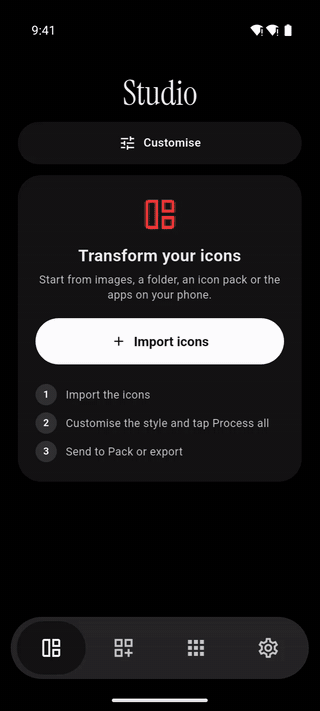
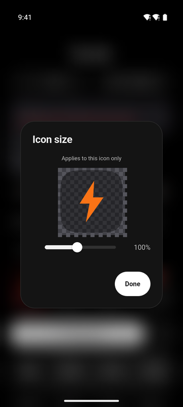
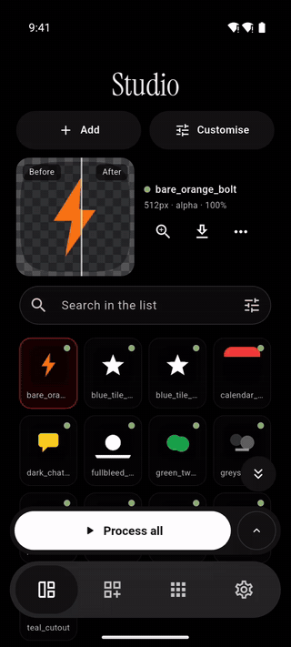
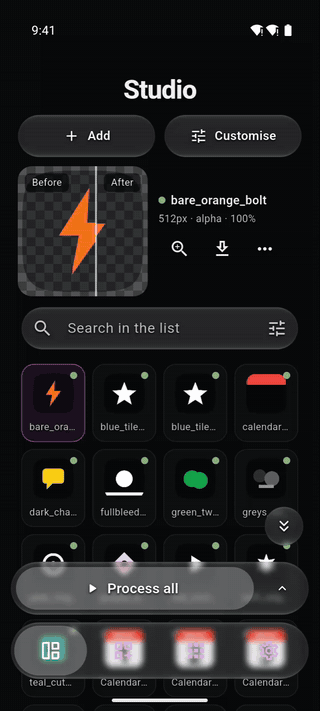
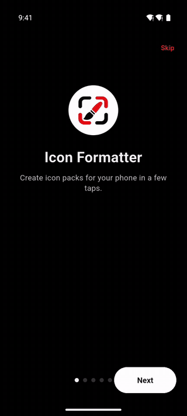
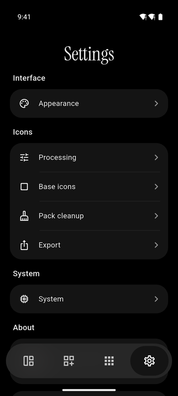

<p align="center">
  
</p>

# Icon Formatter

Icon Formatter turns app icons into one consistent style and builds icon packs you can install. On Android it installs the pack and selects it in the launcher through Shizuku, with no PC and no root.

[](LICENSE)
[](https://github.com/ImSteazyyy/icon-formatter/releases/latest)
[](#install)
[](#build-from-source)

## What it does

Icons collected from different sources rarely match. Each one has its own background, shape and size. Icon Formatter redraws them in one style, matches them to the apps installed on your phone, and packages the result as an icon pack.

The icons use the **Lucent** style: each one sits on a translucent plate, a circle or a squircle that follows the shape of the original icon. The symbol keeps its colours, or takes one colour for the whole set. The app interface has two styles: **Nothing** (black and grey with a red accent, the default) and **Glass**.

Processing happens on the device. The only online services are optional, and they are listed in [Privacy](#privacy).

- **Platform:** Android 7.0 or later.
- **Languages:** Italian, English, Spanish, French, German and Portuguese. The app follows the language of the phone and can be changed in Settings.
- **Cost:** free. No ads, no accounts, no analytics.
- **Licence:** AGPL-3.0-only.

## Features

### Studio

The Studio is where you start. You can import PNG, JPG, WEBP or SVG images, a folder, an icon pack (ZIP or APK), the icons of the apps on your phone, pasted images, or images shared from other apps. A watched folder sends new images to the Studio by itself.

Press **Process all**, and every icon gets the same plate, the same size and the same background.

<p align="center">
  
</p>

After processing you can refine each result:

- correct one icon (size, position, symbol colour, optical centring, plate shape and colour), then copy the correction to all the others with **Apply corrections**;
- undo and redo every change;
- select several icons, search them by name, sort them, and filter them to edited, failed or excluded icons;
- find duplicate files and exclude them with **Exclude duplicates**;
- show the safe-area guide (plate edge and centre cross, in the preview only);
- compare the before and after results by dragging the white line;
- remove the background in one of three ways: the standard method on the device, AI on the device (an optional model), or remove.bg with your own API key.

<p align="center">
  
</p>

<p align="center">
  
</p>

### Styles

- **Lucent:** a translucent dark or light plate on the shape of the original icon (circle or squircle). The symbol stays as it was, with its own colours or in a single colour.
- **Translucent:** the classic style with a semi-transparent plate.
- **Original composition:** every icon keeps its position and proportions inside the size of the base icon you chose.
- **Presets:** Minimal, Flat dark and your own. Presets can be shared as a file and imported on another device.
- **Base icons:** Circle and Squircle are included. You can import your own base and calibrate it with about twenty sample icons, so the margins and the centre are measured instead of guessed.

<p align="center">
  
</p>

### Icon pack builder

The **Pack** tab turns your icons into an icon pack. It works in three steps: **Apps** (the apps that receive new icons), **New icons** (the icons from the Studio or imported files), and **Export**. Press **Match** to pair the new icons with the installed apps.

Each app gets a status: **Matched**, **Checked**, **Uncertain**, **To check** or **Icon missing**. An uncertain match shows the reason it was made: same package, same name, same file name, or visual similarity (for example "similarity 87%"). You can open the details of any match and correct it.

- **Checks** flag icons that are nearly empty, too small, off centre, too dark or low in contrast.
- **Conflicts** flag the same drawing used by several apps, the same component with different drawings, and empty drawings or packages.
- **Suggestions** offer free icons for apps that have none. **Use for other apps** reuses one icon for several apps. Each app can have up to three variants, and any icon can be renamed inside the pack.
- **Coverage** shows how many installed apps already have an icon, for example "12 of 40 apps have their icon".
- **Import matches** reads the matches of another pack (APK or ZIP).
- **Saved packs** store your corrections so you can load them again. The **Pack log** lists what happened and can be copied as release notes.
- **Export** writes a folder, a ZIP or an APK. **Changed only** exports only the icons that changed since the last export.
- **Preview** shows the home screen in **Light** and **Dark**, and contact sheets with all the icons.
- **Pack cleanup** cleans up or merges an icon pack you already have. It keeps the names, the paths and `appfilter.xml`. The original files are never modified.

Less frequent actions sit in the **More** sheet, grouped as **Checks**, **Export and share**, **Pack log**, **Saved packs**, **Open a pack**, **Import**, **Pack cleanup**, **Preview**, **Share** and **Build APK**.

<p align="center">
  
</p>

<p align="center">
  
</p>

### Editing one icon

Open the edit page with **Edit icon** for an app in the Pack, then pick an image (PNG, JPG or WEBP). The **How the icon looks** section shows one tile per treatment, each with a live preview of the icon:

- **Automatic** (recommended): the app picks the best treatment.
- **Symbol only**: removes the background and keeps the drawing.
- **Plate colour**: the symbol takes the colour of the original background.
- **Full edge**: the drawing reaches the edges, which suits maps and keyboards.
- **More options**: **Whole icon** keeps the image as it is, inside the shape; **Original** applies no changes.

The page uses the same style panel as the Studio. Hand-made corrections are saved and reapplied each time the pack is rebuilt.

<p align="center">
  
</p>

## Android

On the phone, the pack comes to life.

- **Your apps:** the apps installed on the phone, with the icon the launcher shows for each one. Process them and send them to the Pack in one tap. Only apps with an icon on the home screen are listed.
- **Install and apply:** the pack is built on the phone as a separate app (`com.iconformatter.pack.device`), starting from a base APK with 2,000 icon slots. It is signed with a key that stays in the Android Keystore. With Shizuku the app installs the pack and selects it in the launcher. Without Shizuku, Android asks you to confirm the install, and you choose the pack yourself.
- **Automatic update:** the app checks when you unlock the phone, then every 6, 12 or 24 hours. You can limit the checks to the time the phone is charging. When an app is new, removed or has a new icon, it appears in the Pack with a silent notification. **Redo** processes only those apps. Apps you do not care about can be left out of the updates.
- **Calendar day:** the calendar icon shows today's date. Icon packs often hold one calendar icon per day, and Icon Formatter combines them into one entry. With Shizuku the pack updates the day every morning, at the time you set with **Update the day at**, or at the first chance. **Update day** applies the change immediately.
- **Sharing and shortcuts:** send images to Icon Formatter from the Android share menu. Long jobs run as a foreground service and show a progress notification, so they keep running when you leave the app.
- **Watched folder:** new images placed in the folder you choose are imported into the Studio.
- **Pack app:** the installed pack has its own app with every icon, a search box, filters (All, Installed, Missing) and sorting. Hold an app to copy its package name or to open it.

<p align="center">
  
</p>

<p align="center">
  
</p>

<p align="center">
  
</p>

<p align="center">
  
</p>

### Large icon sets

Icon Formatter can process thousands of icons. Processing runs in parallel on the processors of the device, in the background, with a progress notification. The repository includes a stress test with 5,000 generated icons, which records time, memory and dropped frames (see [Testing](icon_formatter/docs/TESTING.md)).

Processed results and cut-outs are cached inside the app, so reprocessing an icon is faster. The cut-out cache has a size limit you can set, and you can clear it from Settings.

## Appearance and settings

- **Nothing style:** black and grey cards, serif titles, a red accent and frosted floating bars. It is the only style for now; a Glass style will come later.
- **Light, dark or the phone's setting.** The change starts as a circle from the point you touch.
- **Bottom bar** that bends while you scroll, with compact actions next to it.
- **Power saving:** fewer effects and animations, for longer battery life.
- **Welcome tour:** a short introduction to the language, the automatic updates and the optional permissions. You can replay it from Settings.
- **Backup:** Settings › System › Backup saves the appearance, the styles and the preferences to one file, and restores them later. After many changes the app can also save a copy to a folder you choose, keeping the last three.
- **Copy info:** copies the app version, the system and your settings to the clipboard, without personal data, for bug reports.
- **Accessibility:** the text follows the system font size. Key controls, such as the treatment tiles on the edit page, have labels for screen readers. The text is shown at 93% of the system size.

<p align="center">
  
</p>

<p align="center">
  
</p>

<p align="center">
  
</p>

## Install

Download the latest version from the [Releases](https://github.com/ImSteazyyy/icon-formatter/releases) page.

**Recommended setup:** Nothing OS 5.0 (Android 16) with the Nothing Launcher. The Lucent style and the automatic application of the pack were designed for that setup. Other phones and launchers work too, but see [Known limits](#known-limits).

### Android

Choose the APK for your phone:

- `IconFormatter-<version>-arm64-v8a.apk`: for most phones released in the last few years.
- `IconFormatter-<version>-universal.apk`: if you are not sure, or if the arm64 file does not install.
- `IconFormatter-<version>-armeabi-v7a.apk` and `IconFormatter-<version>-x86_64.apk`: for older 32-bit phones and for x86 emulators.

The first time, Android asks you to allow installs from the app you opened the file with, such as your browser or file manager. The setting usually sits under Settings, in Apps or Security, and its name depends on the manufacturer.

**Upgrading from a build before build 5.** Builds from build 5 onward are signed with the stable release key. Earlier builds were signed with a debug key, and Android refuses to install an update signed with a different key. The first install shows "signatures do not match". Uninstall the old app once, then install the new one. Before you uninstall:

1. Open Settings › System › Backup and save a backup.
2. Uninstall the old app.
3. Install the new APK.
4. Restore the backup from the same screen.

The icon pack already installed on the phone stays where it is. After this one-time step, updates install over the previous version as usual.

Download `IconFormatter-<version>-windows-x64.zip`, extract it to a folder, and run the program from there.

### Shizuku (optional)

[Shizuku](https://shizuku.rikka.app/) is a free app that lets other apps use some system functions without a PC and without root, through the phone's Wireless debugging. With Shizuku running, Icon Formatter installs and selects the pack by itself, updates the calendar day, and runs the automatic updates.

To enable it, install Shizuku, turn on Developer options and Wireless debugging, then start Shizuku from its own app. Shizuku stops when the phone restarts, so start it again after each restart. Icon Formatter asks for the Shizuku permission the first time it needs it.

### Applying the pack

Open the Pack, build the pack, and tap **Apply in the launcher**:

- **With Shizuku:** choose **Install and apply**. The app shows its progress ("Building the pack on the phone…", "Installing the pack…", "Selecting the pack in the launcher…") and ends with "Pack applied: N icons."
- **Without Shizuku:** choose **Install (with system confirmation)**. Confirm the install in the system window, then select the pack in your launcher's icon pack settings.
- **By hand:** choose **Export** and save a folder, a ZIP or an APK. Install it with any icon pack flow you already use.

## How to use it

1. **Import** icons into the Studio: images, a folder, an icon pack, or the apps on your phone.
2. **Choose a style** and press **Process all**. Icons marked in yellow are uncertain. Check them and correct them by hand.
3. **Send to Pack** and press **Match**. Review the uncertain matches before you export.
4. **Install and apply** on Android with Shizuku, or **export** a folder, ZIP or APK and install it yourself.
5. On Android, the pack keeps itself up to date when you install, remove or change apps.

## Build from source

The Flutter project is in the `icon_formatter/` folder.

Requirements:

- **Flutter:** the package needs the Dart SDK `^3.13.7`, as set in the `environment` section of `icon_formatter/pubspec.yaml`. Use a stable Flutter release that bundles this Dart version.
- **Rust:** a stable toolchain with `cargo`. The engine uses the 2021 edition.
- **flutter_rust_bridge_codegen 2.13.0**, the same version as the Dart package: `cargo install flutter_rust_bridge_codegen --version 2.13.0`.
- **Android:** the Android SDK, the NDK that Flutter selects, and JDK 17.
- **Python 3** with **Pillow** for the scripts in `tool/`.

From `icon_formatter/`:

```bash
flutter pub get
flutter_rust_bridge_codegen generate   # only after changing the Rust API in rust/src/api
cargo test --release --manifest-path native/icon_core/Cargo.toml
flutter test test
flutter build apk --release --split-per-abi
```

To sign a release with your own key, create `android/key.properties` with `storeFile`, `storePassword`, `keyAlias` and `keyPassword`. Without that file, the release build uses the debug key. That is fine for testing, but not for distribution.

Support scripts:

| Script | Purpose |
|---|---|
| `tool/l10n_gen.py` | Regenerates the languages in `lib/l10n` from `source_it.dart` and the `tool/l10n/*.tsv` files. Run `dart format lib/l10n` afterwards. With `--check`, it lists the missing keys for each language. |
| `tool/make_template_zip.py` | Rebuilds `assets/iconpack_template.zip` from the `iconpack_template/` project after you change the template. |
| `tool/make_base_apk.py` | Rebuilds `assets/iconpack_base.apk`, the base APK with 2,000 icon slots. Needs the Android SDK and JDK. |
| `tool/make_bases.py` | Draws the Circle and Squircle base icons in `assets/bases/`. Needs Pillow. |
| `tool/make_app_icon.py`, `tool/make_pack_icon.py` | Create the launcher icons from the files in `assets/branding/`. Need Pillow. |
| `tool/unconst_strings.py` | A one-time utility that removed `const` from expressions with translated strings. It is not needed to build. |

Tests and the release process are described in [icon_formatter/docs/TESTING.md](icon_formatter/docs/TESTING.md) and [docs/RELEASE.md](docs/RELEASE.md).

## Project structure

```
.
├── CHANGELOG.md, LICENSE, THIRD_PARTY_NOTICES.md
├── docs/media/              images used by this README
└── icon_formatter/          the app
    ├── lib/                 Flutter interface: app state, screens (Studio, Pack, Settings), workspace, services, widgets, l10n
    ├── native/icon_core/    Rust engine: symbol cut-out, plates and shapes, composition, icon matching, pack writing
    ├── rust/                flutter_rust_bridge layer (crate icon_bridge)
    ├── rust_builder/        Cargokit integration that compiles Rust inside the Flutter build
    ├── android/             Android app: installed apps, Shizuku, automatic updates, on-device pack, sharing
    ├── iconpack_template/   the pack project the base APK is built from
    ├── assets/              base icons, fonts, branding, base APK, template ZIP, release notes
    ├── tool/                build and maintenance scripts
    └── test/, integration_test/
```

## Privacy

- The app works offline. Background removal runs on the device, with the standard method or with the local AI model.
- There are no accounts, analytics, telemetry or automatic crash reports. The project includes no SDK of this kind.
- The app connects to the internet only in these cases:
  - **remove.bg**, only if you choose that method and save your own API key. Each image you process is sent to remove.bg. Checking the key and reading your credits also call the remove.bg API.
  - **Update check**, once per start: the app asks `api.github.com` for the latest published release and tells you if a newer version exists. It is on by default and can be turned off in Settings › System. It installs nothing by itself.
  - **AI model download**, only when you tap **Download**. The U²-Net-p model (about 4.6 MB) comes from the GitHub releases of the rembg project.
  - **External links:** the Ko-fi page and the remove.bg pricing page open in your browser, and only when you tap them.
- The remove.bg API key is kept in the operating system's secure storage.
- The app asks for these permissions: internet access (for the cases above), notifications (optional, for progress and new-app alerts), permission to install apps (only to install the pack), and the Shizuku permission (optional).
- On Android the app does not declare `QUERY_ALL_PACKAGES`. It sees only the apps it needs: launchers and compatible pack apps.
- The info you copy for a bug report contains no personal data.

## Known limits

- Tested only with the Nothing Launcher on Nothing OS 5.0 (Android 16). On other launchers the pack installs as a normal icon pack, but automatic application with Shizuku is designed for the Nothing Launcher.
- On Android, only apps with an icon on the home screen are listed. Apps without a home-screen icon and apps in a work profile do not appear.
- A pack built on the phone holds at most 2,000 icons.
- Without Shizuku, Android does not allow a silent install or selecting the pack in the launcher automatically.
- A pack made on another phone cannot be updated in place. Icon Formatter then offers to replace it, keeping the same icons and your changes.
- After you uninstall the pack, Android may keep its data. **Delete leftover data** in the Pack removes it when Android allows it.
- Background removal is rule-based. Uncertain results are marked in yellow so you can correct them by hand.
- The 5,000-icon stress test is a benchmark to compare versions. Its memory budget is a chosen threshold, not a measurement of any phone, and results depend on the device.

## Support

Icon Formatter is free. If you find it useful, you can buy the developer a coffee on [Ko-fi](https://ko-fi.com/imsteazyy). The link is also in the **Support the project** card in Settings.

To report a problem, open an issue on [GitHub](https://github.com/ImSteazyyy/icon-formatter/issues) and attach the output of **Copy info** from Settings › System.

## Licence and credits

Icon Formatter is licensed under [AGPL-3.0-only](LICENSE). The Lucent rendering engine contains code derived from [nothing-icongen](https://github.com/linuxct/nothing-icongen) by linuxct, which is also AGPL-3.0-only. The Inter and Instrument Serif fonts are licensed under the SIL Open Font License 1.1. The full list of third-party components is in [THIRD_PARTY_NOTICES.md](THIRD_PARTY_NOTICES.md) and on the Licences page of the app.

Icon Formatter is an independent project and is not affiliated with Nothing Technology Limited, Google or any other company whose name appears here. Product names, logos and trademarks belong to their owners and are mentioned only to indicate compatibility. The "Nothing" style is the name of one of the app's looks and is not a claim of endorsement. The repository distributes no third-party icons: the app works on the icons present on the user's own device.

Developed with Claude (Anthropic) through Claude Code. Claude is listed as a co-author of the commits.
