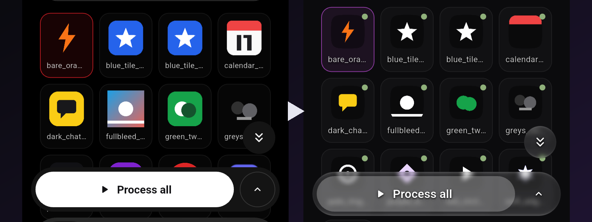
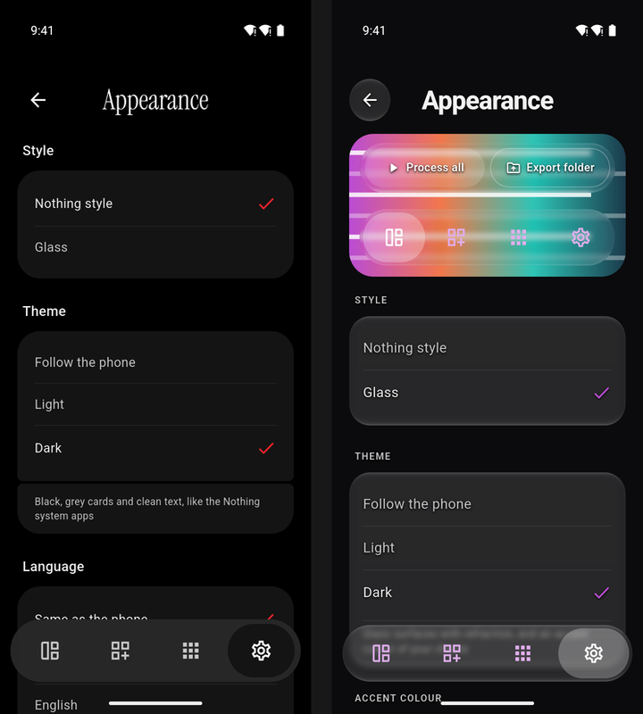

<p align="center">
  
</p>

# Icon Formatter

Trasforma le icone delle app in uno stile uniforme e crea icon pack pronti da installare. Su Android installa e applica il pack nel launcher con Shizuku, senza PC e senza root.

[](LICENSE)
[](https://github.com/ImSteazyyy/icon-formatter/releases/latest)
[](#installazione)
[](#compilare-dal-sorgente)

## Cosa fa

Le icone che hai raccolto arrivano da posti diversi, con sfondi, forme e dimensioni che non combaciano. Icon Formatter le riporta tutte allo stesso stile, ti aiuta ad abbinarle alle app installate e crea il pacchetto. Gira su Android e su Windows. L'elaborazione avviene sul dispositivo; un servizio online entra in gioco solo se scegli tu di usarlo per togliere lo sfondo.

## In breve

| Area | Cosa ottieni |
|---|---|
| Studio | Importi immagini, cartelle, icon pack, app del telefono, appunti o condivisioni, e le porti nello stesso stile. |
| Stili | Lucent (piatto traslucido), stile traslucido classico, composizione originale, preset e basi tue. |
| Pack | Abbinamento alle app, controllo di ogni abbinamento, esportazione in cartella, ZIP o APK. |
| Android | Installazione e applicazione del pack con Shizuku, aggiornamento automatico, calendario con il giorno di oggi. |
| Aspetto | Stile Nothing o Vetro, in chiaro, scuro o come il telefono, con risparmio energetico. |
| Lingue | Italiano, inglese, spagnolo, francese, tedesco e portoghese. |

## Studio

Lo Studio è il punto di partenza. Importi immagini (PNG, JPG, WEBP o SVG), una cartella, un icon pack in ZIP o APK, oppure le app installate sul telefono. Puoi incollare dagli appunti e ricevere immagini dal menu Condividi di Android. Scegli lo stile, premi **Elabora tutte** e ogni icona esce con lo stesso piatto, la stessa dimensione e lo stesso sfondo.

<p align="center">
  
</p>

Dopo l'elaborazione puoi rifinire il risultato:

- correggere una singola icona (dimensione, posizione, colore del simbolo, centratura ottica, forma e colore del piatto) e copiare la correzione su tutte le altre;
- annullare e ripristinare ogni modifica;
- selezionare più icone, cercarle per nome, ordinarle e filtrarle (solo modificate, solo con errori, solo escluse);
- riconoscere le icone duplicate ed escluderle con un tocco;
- mostrare la guida dell'area sicura, con il contorno del piatto e la croce al centro, solo nell'anteprima;
- confrontare due stili sulla stessa icona;
- togliere lo sfondo in tre modi: metodo standard sul dispositivo, AI locale con un modello facoltativo, oppure remove.bg con una tua chiave API.

<p align="center">
  
</p>

## Stili

- **Lucent**: un piatto traslucido, scuro o chiaro, sulla forma dell'icona originale (cerchio o squircle). Il simbolo resta com'era, con i suoi colori oppure in un colore solo.
- **Traslucido**: lo stile classico con il piatto semitrasparente.
- **Composizione originale**: ogni icona mantiene la posizione e le proporzioni dell'originale, dentro la dimensione dell'icona base scelta.
- **Preset**: Minimale, Scuro piatto e quelli che crei tu. I preset si esportano in un file e si importano su un altro dispositivo.
- **Basi**: Cerchio e Squircle sono incluse. Puoi importare una tua base e calibrarla con una ventina di icone di esempio, così margini e centro vengono misurati.

<p align="center">
  
</p>

## Pack

Il Pack è dove le icone diventano un icon pack. Scegli le app, aggiungi le icone nuove (dallo Studio o importate) e premi **Abbina**. Ogni app riceve uno stato (abbinata, verificata, incerta, da verificare o icona mancante). Per le incerte puoi vedere il motivo dell'abbinamento: stesso componente, stesso pacchetto, stesso nome, stesso nome di file o somiglianza visiva.

- **Dettagli con prima e dopo** per ogni abbinamento, con le ragioni.
- **Controllo qualità**: segnala icone quasi vuote, troppo piccole, fuori centro, troppo scure o con poco contrasto.
- **Conflitti**: stesso disegno per più app, stesso componente con disegni diversi, disegni o pacchetti vuoti.
- **Suggerimenti** di icone libere per le app senza icona, alias per usare la stessa icona su altre app, fino a tre varianti per app e rinomina nel pack.
- **Copertura**: quante app del telefono hanno ormai la loro icona.
- **Importa abbinamenti** da un altro pack, in APK o ZIP.
- **Pack salvati** e un registro delle operazioni che puoi copiare.
- **Esportazione** in cartella, ZIP o APK, anche solo delle icone modificate dall'ultima volta.
- **Anteprima della schermata home**, in chiaro e in scuro, e anteprima di tutte le icone.
- **Pulizia pack**: ripulisce o unisce un icon pack che hai già, mantenendo nomi, percorsi e `appfilter.xml`. Gli originali non vengono toccati.

## Android

Sul telefono il pack prende vita.

- **Le tue app**: l'elenco delle app installate con l'icona che usa il launcher. Le elabori e le mandi al Pack in un tocco. Compaiono solo le app che hanno un'icona nella schermata home.
- **Installa e applica**: il pack viene creato sul telefono come app separata, a partire da un modello con 2000 posti per le icone, e firmato con una chiave che resta nell'Android Keystore. Con Shizuku lo installi e lo selezioni nel launcher senza PC. Senza Shizuku la conferma la dà il sistema e la scelta la fai a mano. Le correzioni fatte a mano restano salvate e vengono riapplicate a ogni rigenerazione.
- **Aggiornamento automatico**: il controllo parte allo sblocco e poi ogni 6, 12 o 24 ore, facoltativamente solo mentre il telefono è in carica. Se un'app è nuova, è stata rimossa o ha cambiato icona, la trovi nel Pack con una notifica silenziosa, e **Rielabora** lavora solo su quelle. Le app che non ti interessano si possono escludere dall'elenco.
- **Calendario dinamico**: l'icona del calendario mostra il giorno di oggi. Con Shizuku il pack aggiorna il giorno da solo, ogni mattina, all'ora che scegli oppure alla prima occasione.
- **Condivisione e scorciatoie**: mandi immagini ad Icon Formatter dal menu Condividi, alla voce «Condividi con Icon Formatter». Dalla schermata home puoi avviare il controllo ora o aggiornare il giorno del calendario.
- **Cartella osservata**: le immagini nuove che finiscono nella cartella che scegli arrivano nello Studio da sole.
- **Controllo aggiornamenti**: all'avvio l'app verifica se è uscita una versione nuova e te lo segnala in Impostazioni › Sistema, senza installare nulla da sola.
- **Elaborazione in background**: un lavoro lungo mostra una notifica con l'avanzamento.
- **L'app del pack**: il pack ha una sua schermata con tutte le icone, ricerca, filtri (tutte, installate, mancanti) e ordinamento. Tenendo premuta un'app copi il nome del pacchetto o la apri.

<p align="center">
  
</p>

## Aspetto

- **Stile Nothing** (predefinito): nero, card grigie, titoli serif e accento rosso.
- **Vetro**: superfici in vetro con rifrazione, smerigliatura e bordo luminoso. Si regola in Impostazioni › Vetro, dove scegli anche dove usarlo e il livello di qualità (Più veloce, Bilanciato, Qualità).
- **Chiaro, scuro o come il telefono**. Il cambio tema si apre a cerchio dal punto che tocchi.
- **Barra in basso** che si piega mentre scorri.
- **Risparmio energetico**: riduce effetti e animazioni per avere più autonomia.
- **Tour iniziale** con le cose essenziali e i permessi, tutti facoltativi. Lo rivedi quando vuoi con **Rivedi il tour** nelle Impostazioni.
- **Backup**: salvi aspetto, stili e preferenze in un file e li ripristini quando vuoi. Dopo molte modifiche l'app può salvare anche una copia automatica nella cartella che scegli, tenendo le ultime tre.
- **Copia info** per segnalare un problema: versione, sistema e impostazioni, senza dati personali.
- **Su Windows**: Ctrl+1 fino a Ctrl+4 per le prime quattro sezioni, Ctrl+, per le Impostazioni, Ctrl+Maiusc+T per passare dal chiaro allo scuro.

<p align="center">
  
</p>

<p align="center">
  
</p>

<p align="center">
  
</p>

## Lingue

L'app è disponibile in italiano, inglese, spagnolo, francese, tedesco e portoghese. Segue la lingua del telefono. Per cambiarla vai in Impostazioni › Aspetto.

## Installazione

Scarica l'ultima versione dalla pagina [Releases](https://github.com/ImSteazyyy/icon-formatter/releases).

Consigliato: **Nothing OS 5.0 (Android 16)** con il Nothing Launcher. È il sistema per cui sono pensati lo stile Lucent e l'applicazione automatica del pack.

Requisiti minimi: Android 7.0 o successivo, oppure Windows 10 o 11 a 64 bit. Su altri telefoni e launcher l'app funziona e il pack si installa come un normale icon pack, ma l'applicazione automatica con Shizuku è pensata per il Nothing Launcher.

- **Android**: prendi l'APK `arm64-v8a`. Quasi tutti i telefoni degli ultimi anni lo supportano. Se non sei sicuro, o se quello non si installa, usa l'APK universale, quando la release lo include.
- **Windows**: scarica lo ZIP, estrailo in una cartella e avvia il programma da lì.

Al primo tentativo Android chiede di consentire l'installazione dall'app con cui apri il file, per esempio il browser o il gestore dei file. La voce si trova di solito in Impostazioni, nelle sezioni App o Sicurezza, e cambia da un produttore all'altro.

### Shizuku (facoltativo)

[Shizuku](https://shizuku.rikka.app/) è un'app gratuita che permette ad altre app di usare alcune funzioni di sistema senza PC e senza root, grazie al Debug wireless del telefono. Con Shizuku attivo, Icon Formatter installa e seleziona il pack da solo, aggiorna il giorno del calendario e applica gli aggiornamenti automatici. Senza Shizuku, il sistema chiede conferma e la scelta del pack nel launcher la fai a mano.

Per attivarlo: installa Shizuku, attiva le opzioni sviluppatore e il Debug wireless, poi avvia Shizuku dalla sua app. Dopo ogni riavvio del telefono va avviato di nuovo. Icon Formatter chiede il permesso la prima volta che lo usi.

## Come si usa

1. **Importa** le icone nello Studio: immagini, una cartella, un icon pack o le app del telefono.
2. **Scegli lo stile** e premi **Elabora tutte**. Le icone segnate in giallo sono incerte: controllale e correggile a mano.
3. **Manda al Pack** e premi **Abbina**. Controlla gli abbinamenti incerti prima di esportare.
4. **Installa e applica** su Android con Shizuku, oppure **esporta** cartella, ZIP o APK e installalo a mano.
5. Su Android il pack si tiene aggiornato da solo quando installi, rimuovi o cambi app.

## Compilare dal sorgente

Il progetto Flutter sta nella cartella `icon_formatter/`.

Requisiti:

- **Flutter**: il pacchetto richiede Dart `^3.13.7` (campo `environment` in `icon_formatter/pubspec.yaml`). Usa un Flutter stable che includa questa versione di Dart.
- **Rust**: una toolchain stabile con `cargo`. Il motore usa l'edizione 2021.
- **flutter_rust_bridge_codegen 2.13.0**, la stessa versione del pacchetto Dart: `cargo install flutter_rust_bridge_codegen --version 2.13.0`.
- **Android**: Android SDK, NDK (quello indicato da Flutter) e JDK 17.
- **Python 3** con **Pillow** per gli script in `tool/`.

Da `icon_formatter/`:

```bash
flutter pub get
flutter_rust_bridge_codegen generate   # solo se cambi l'API Rust in rust/src/api
cargo test --release --manifest-path native/icon_core/Cargo.toml
flutter test test
flutter build apk --release --split-per-abi
flutter build windows --release
```

Per firmare la release con una tua chiave crea `android/key.properties` con `storeFile`, `storePassword`, `keyAlias` e `keyPassword`. Senza quel file la release usa la chiave di debug: va bene per le prove, non per distribuire.

Script di supporto:

| Script | A cosa serve |
|---|---|
| `tool/l10n_gen.py` | Rigenera le lingue in `lib/l10n` dai testi italiani in `source_it.dart` e dai file `tool/l10n/*.tsv`. Poi esegui `dart format lib/l10n`. Con `--check` elenca le chiavi mancanti per lingua. |
| `tool/make_template_zip.py` | Ricrea `assets/iconpack_template.zip` dal progetto `iconpack_template/`, dopo una modifica al template. |
| `tool/make_base_apk.py` | Ricrea `assets/iconpack_base.apk`, il modello con 2000 posti per le icone. Richiede Android SDK e JDK. |
| `tool/make_bases.py` | Disegna le basi Cerchio e Squircle in `assets/bases/`. Richiede Pillow. |
| `tool/make_app_icon.py`, `tool/make_pack_icon.py` | Creano le icone di lancio e l'`.ico` di Windows dai file in `assets/branding/`. Richiedono Pillow. |
| `tool/unconst_strings.py` | Utility usata una volta per togliere `const` dalle espressioni con testi tradotti. Non serve per compilare. |

## Struttura del progetto

```
.
├── CHANGELOG.md, LICENSE, THIRD_PARTY_NOTICES.md
├── docs/media/              immagini del README
└── icon_formatter/          l'app
    ├── lib/                 interfaccia Flutter: app, screens, workspace, services, widgets, l10n
    ├── native/icon_core/    motore Rust: isolamento del simbolo, piatti, composizione, abbinamento, pack
    ├── rust/                ponte flutter_rust_bridge (crate icon_bridge)
    ├── rust_builder/        integrazione Cargokit per compilare Rust dentro il build Flutter
    ├── android/             app Android: app installate, Shizuku, aggiornamenti, pack sul telefono, condivisione
    ├── iconpack_template/   progetto del pack, da cui nasce il modello APK
    ├── assets/              basi, font, branding, modello APK, template ZIP, testo delle novità
    ├── tool/                script di build e manutenzione
    ├── windows/             progetto Windows
    └── test/, integration_test/
```

## Privacy

- L'app funziona offline. Lo sfondo si toglie sul dispositivo, con il metodo standard o con l'AI locale.
- Non ci sono account, analytics, telemetria né segnalazione automatica dei crash: nel progetto non c'è nessun SDK di questo tipo.
- L'app si collega a internet solo in questi casi:
  - **remove.bg**, se scegli questo metodo e salvi una tua chiave API. Ogni immagine viene inviata a remove.bg. Il test della chiave e la lettura dei crediti chiamano anche loro l'API di remove.bg.
  - **Controllo aggiornamenti**: una volta per avvio, l'app chiede a `api.github.com` l'ultima release pubblicata del progetto e ti avvisa se ce n'è una nuova. Si spegne in Impostazioni › Sistema ed è attivo di default.
  - **Download del modello AI**, solo se premi Scarica. Il modello U²-Net-p (circa 4,6 MB) viene dalle release del progetto rembg su GitHub. Il modello ISNet, disponibile solo su Windows, pesa circa 178 MB.
  - **Link esterni**: Ko-fi e la pagina dei prezzi di remove.bg si aprono nel browser solo quando li tocchi.
- La chiave di remove.bg viene salvata nell'archivio sicuro del sistema.
- Su Android l'app non dichiara `QUERY_ALL_PACKAGES`: vede solo le app che le servono e le app di launcher e pack compatibili.
- La copia info per le segnalazioni non contiene dati personali.

## Sostieni il progetto

Icon Formatter è gratuito. Se ti è utile, puoi offrirmi un caffè su [Ko-fi](https://ko-fi.com/imsteazyy). Il link è anche nella scheda "Sostieni il progetto" delle Impostazioni.


## Licenza e crediti

Icon Formatter è distribuito con licenza [AGPL-3.0-only](LICENSE). Il motore di rendering Lucent contiene codice derivato da nothing-icongen di linuxct, anch'esso AGPL-3.0-only. I font Inter e Instrument Serif sono sotto SIL Open Font License 1.1. L'elenco completo dei componenti di terze parti è in [THIRD_PARTY_NOTICES.md](THIRD_PARTY_NOTICES.md) e nella pagina Licenze dell'app.

Nomi di prodotti e loghi citati (Android, Windows, Shizuku, remove.bg, Ko-fi e gli altri) appartengono ai rispettivi proprietari. Il progetto è indipendente e non è affiliato a nessuno di loro. Il nome dello stile "Nothing" è un nome interno dell'app. Il repository non distribuisce icone di terze parti: l'app lavora sulle icone presenti sul dispositivo dell'utente.

Sviluppato con Claude (Anthropic), tramite Claude Code: Claude è co-autore dei commit.
